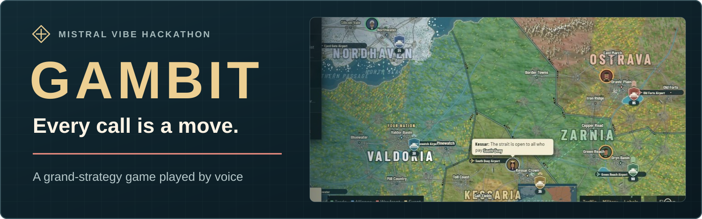
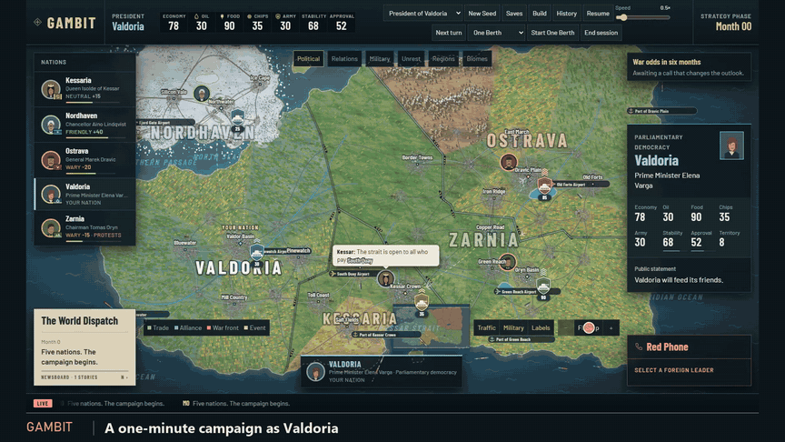
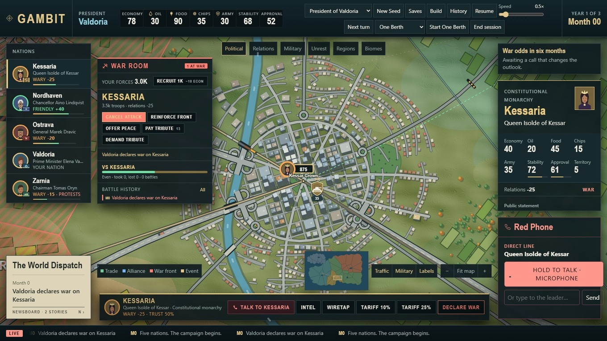
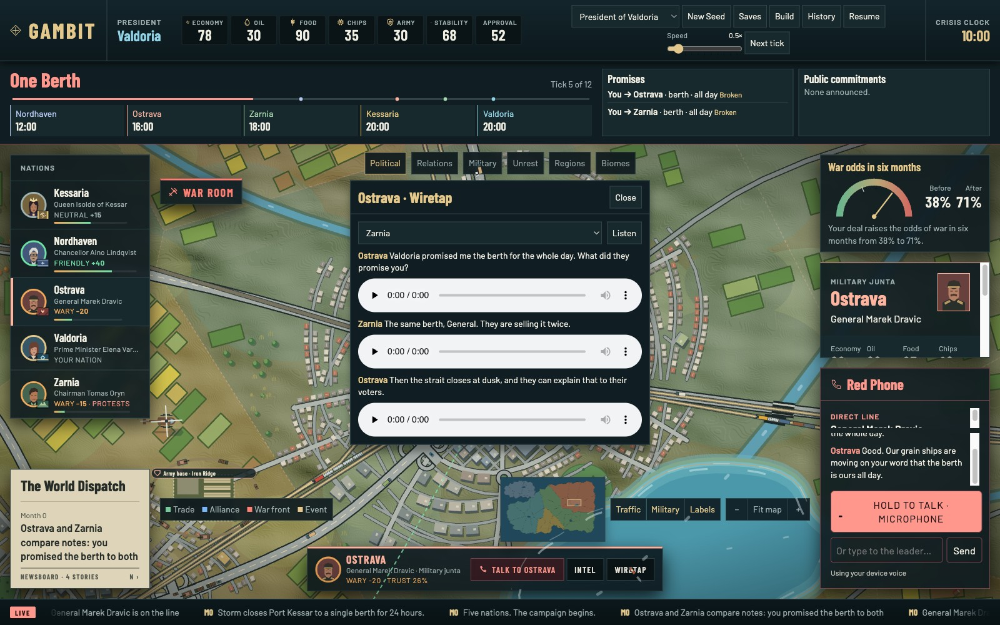
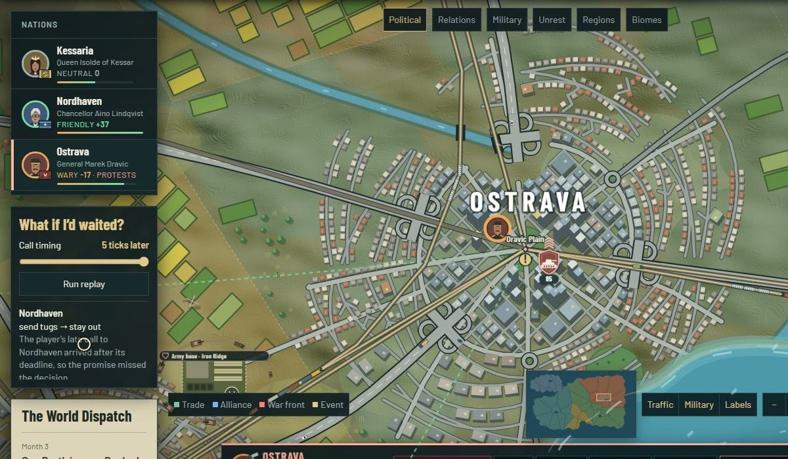
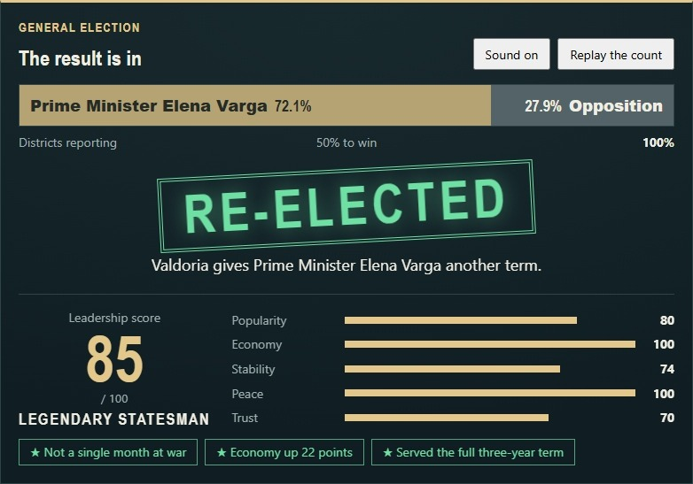

<div align="center">



<br>

## 🏆 Winner · Best Use of the Voxtral API

[Mistral Vibe Hackathon · Le Chonk in London](https://luma.com/le-chonk-in-london) · 21 November 2026

GAMBIT is a grand-strategy game played through the Red Phone. Speak to five AI leaders, govern a nation, or mediate a crisis. Replay the decisions to see what changes when you call later.

[](#how-it-works)
[](voice/VOXTRAL.md)
[](#quickstart)
[](engine/)
[](web/)
[](web/)
[](gambit_mcp/)

<p>
  <a href="#quickstart"><b>Quickstart</b></a> ·
  <a href="#how-it-works"><b>How it works</b></a> ·
  <a href="#a-tour-of-the-game"><b>Tour</b></a> ·
  <a href="#emotional-intelligence"><b>Emotional intelligence</b></a> ·
  <a href="#measured-performance"><b>Benchmarks</b></a> ·
  <a href="#documentation"><b>Docs</b></a>
</p>



</div>

## The project

In GAMBIT, five rival nations share a continent, trade routes, and problems they can’t solve alone. As president, you build an economy and decide when to negotiate, sanction, or fight. As mediator, you can only see public positions, and your score depends on peace across the continent and the trust you earn.

The Red Phone sits inside that simulation. A concession can buy time for an ally or give a rival a way to back down. Leaders can send private dispatches, compare promises, and use what they learn against you. The map, election results, and Historian’s verdict show where those decisions led.

## Quickstart

You’ll need Python 3.12+, Node.js 20.19+ or 22.12+, and a Mistral API key for live calls. On Windows, use Git Bash.

```bash
git clone https://github.com/Infosuii/Mistral-Hackathon.git
cd Mistral-Hackathon
```

Create a `.env` file in the project root with `MISTRAL_API_KEY=your_key_here`, then launch the game.

```bash
./scripts/demo.sh
```

Open [localhost:5173](http://localhost:5173) in Chrome. Hold the red button to speak, release it to send, or type your side of the call. To interrupt, press the button while the leader is speaking. The launcher installs missing dependencies and starts the API on port 8000.

<details>
<summary><strong>Play offline, check live setup, or change ports</strong></summary>

Install Python and web dependencies while online. For a fresh Linux or macOS checkout:

```bash
python3 -m venv .venv
.venv/bin/python -m pip install -r requirements.txt
(cd web && npm ci)
./scripts/demo.sh --offline
```

On Windows, use `.venv/Scripts/python.exe` for the project interpreter. Offline mode uses fixed replies and a sample microphone transcript. Incoming calls and Wiretap play from shipped recordings.

Run `python scripts/preflight.py` from the project environment to check live credentials, models, speech, and transcription. To change both ports, run `./scripts/demo.sh --backend-port 8010 --web-port 5180`.

</details>

## How it works

| Stage | What happens |
| --- | --- |
| **You speak** | Voxtral transcribes hold-to-talk audio with context for names such as *Ostrava* and *Port Kessar*. The browser supplies the [timing cues](#emotional-intelligence). Typed calls use the same negotiation logic. |
| **The leader replies** | Mistral Large 2512 writes a short, in-character answer. Mistral Medium can race a slow response. The reply model selects an emotion and Voxtral streams it in the leader’s cast voice. |
| **The game records the deal** | Mistral Large 4 interprets promises, agreed actions, trust, and resolve in the background. |
| **Nations make their moves** | Large 4 writes private strategies. Mistral Medium chooses from legal moves scored by the advisers. Leaders can send private dispatches and state a public position that differs from their intent. |
| **You test the consequences** | The engine compares matched-seed war forecasts before and after a deal. Crisis replay shifts the recorded calls by up to five ticks and reruns the decisions. Mistral explains the changes. |

**Mistral Vibe** connects to the running game through [eight MCP tools](gambit_mcp/README.md). Run `/gambit-brief` to see who acts next and what you could say, or `/gambit-crisis-card` to draft a playable scenario from one sentence.

## A tour of the game

| The campaign | The War Room |
| --- | --- |
|  |  |
| Govern one of five nations for up to three years. Build in your provinces, sign trade deals, set tariffs, and save your campaign. Rail, road, and air connections respond to diplomacy. | Declare war during the campaign, including during a crisis. Recruit, march, and reinforce troops, then negotiate peace, tribute, or a pact. Battles run on a separate real-time clock. |

| The Red Phone | Wiretap |
| --- | --- |
|  |  |
| Speak or type a concrete offer before the leader decides. Public commitments and broken promises can change their options. | Open Intel to compare a leader’s public position with their private strategy. Listen to rivals talk in their own voices. Mediators work from public positions. |

| The replay | The election |
| --- | --- |
|  |  |
| Ask *“What if I’d waited?”* and see which crisis decisions would change. The War-Odds Needle compares the next six months of simulated risk. | Face yearly approval reviews and a leadership score out of 100. The Historian writes its verdict from the session log. An election loss or coup can end a term early. |

### Gameplay walkthrough

https://github.com/user-attachments/assets/677c797e-3762-4e1a-99d4-2602ae3986f6

8:30 · 1080p gameplay recording.

## Emotional intelligence

**A leader reacts to how you handle the call as well as what you say.** We tuned two kinds of signal together.

| What we tuned | What it changes |
| --- | --- |
| **Interruptions and hesitation** | The browser detects whether you cut off a leader mid-sentence and measures how long you wait after their reply. A pause over **2.5 s** lowers perceived resolve. Interrupting raises resolve, but proud leaders such as Dravic and Oryn can take it as an insult. |
| **Trust and resolve** | We score them separately. You can sound determined while giving a leader less reason to trust you. Interrupting a blockade announcement can keep the threat off the public record and give the leader room to back down. |
| **Voice and emotional delivery** | We cast five distinct Voxtral voices. The leader model chooses from **15 emotion tags** using the conversation, timing cues, and persona. Voxtral renders the tag as spoken delivery. Player-side analysis uses the Voxtral transcript and timing measured by the browser. |

**Hear the tuning.** The same sentence and the same Voxtral voice, with two different emotion tags. [Calm](https://raw.githubusercontent.com/Infosuii/Mistral-Hackathon/main/docs/assets/voxtral-emotion-calm.mp3) · [Angry](https://raw.githubusercontent.com/Infosuii/Mistral-Hackathon/main/docs/assets/voxtral-emotion-angry.mp3)

[Voice casting and audition notes](voice/CASTING.md) · [Benchmarks and blind listening test](voice/VOXTRAL.md#measured)

## The systems behind the game

| System | What it lets you do |
| --- | --- |
| **Private diplomacy** | Read a leader’s public line against their private strategy, adviser rankings, and actual choice. Leaders also send dispatches to one another. Those messages enter the recipient’s next turn, and you can see some of the manoeuvring in Intel and Wiretap. |
| **Political and economic consequences** | Trade opens cross-border freight routes and war closes them. Capturing a province changes who gets its output. At home, a major crisis can become an approval problem for a democracy or a stability crisis for a junta. |
| **Counterfactual replay** | Move the recorded calls and rerun the crisis from the same starting state using the engine rules and cached leader choices. A zero-tick shift reproduces the decisions. The War-Odds Needle separately uses matched seeds to compare the simulated six-month risk before and after your intervention. |
| **Different emergencies and roles** | Four crises cover a port closure, a health emergency, a coup, and an oil cutoff. Each gives leaders different deadlines and decisions. Play as a neutral mediator to negotiate while all five nations run themselves. |

[Open the guided One Berth demo](voice/DEMO.md) · [Browse the crisis definitions](data/crises/)

## Measured performance

| Measurement | Observed result |
| --- | --- |
| **Blind emotion test** | One listener correctly identified **6/6** shuffled clips across two voices with calm, tense, and angry tags. |
| **Calm to angry pitch change** | With the sentence held constant, pitch rose **32% for Howard** (119 → 157 Hz) and **37% for Harriet** (174 → 238 Hz). |
| Typed line to first leader audio | About **1.8 s**, estimated by adding the **1.39 s** reply and **0.39 s** first-chunk medians across 10 live calls. |
| Browser microphone transcription | **0.25–0.37 s** in a separate six-call Chrome WebM/Opus test. The 220 KB WAV uploads took **3.32 s** median. |
| Human playtest | **13/13** calls transcribed and voiced without fallback in a One Berth playtest. |
| Simulated room noise | **98.4%** word accuracy on 18 lines with synthetic babble and hum at **10 dB SNR**. |
| Final demo path | **11** live steps passed in **139 s**. The forecast took **2.5 s** for 120 rollouts. Replay took **4.6 s** including written explanations. |

[Voice benchmarks and methodology](voice/VOXTRAL.md) · [Demo timings](e2e/timings.py)

<details>
<summary><strong>Implementation and playtest notes</strong></summary>

Background interpretation took 13.10 s median and 21.44 s at its slowest in the ten-call benchmark. Reply audio starts before interpretation finishes. The [early Managed Agents prototype](agents/A0_RESULTS.md) took 9.6 s for its first turn. The game’s leader runtime uses Mistral Chat Completions with session memory.

One Berth received the most live playtesting. The other three crises were exercised offline. War, economy, and elections were integrated near the end of the hackathon. Concurrent games share a Mistral API key and can slow each other down.

</details>

## Documentation

| Area | Start here |
| --- | --- |
| Voice and demo operation | [Voxtral implementation](voice/VOXTRAL.md) · [Demo runbook](voice/DEMO.md) |
| Rules, battles, and forecasting | [Engine](engine/) · [War Room](war/) · [Crisis replay](replay/) |
| Leaders and Mistral Vibe | [Leader personas](agents/personas/) · [MCP setup and skills](gambit_mcp/README.md) |
| App, API, and scenario data | [React client](web/) · [Contracts](contracts/) · [Writing crisis cards](data/crises/README.md) |
| Reproducible runs | [Demo path](e2e/demo_path.py) · [Browser walkthrough](e2e/walkthrough.py) · [Crisis walkthrough](e2e/crisis_cards.py) |

<details>
<summary><strong>Run the checks</strong></summary>

From the project’s Python environment:

```bash
python -m pytest -q
./scripts/smoke.sh
```

For live runs with a Mistral API key:

```bash
python -m e2e.demo_path
python -m e2e.timings
```

For browser walkthroughs, install Playwright with `python -m pip install playwright` and `python -m playwright install chromium`. Then run `python -m e2e.walkthrough --offline` or `python -m e2e.crisis_cards`.

</details>

## Team

Tamim Atiqur, Om Dhande, Abi, and Ashish Kadari built GAMBIT in one day at Le Chonk in London.
