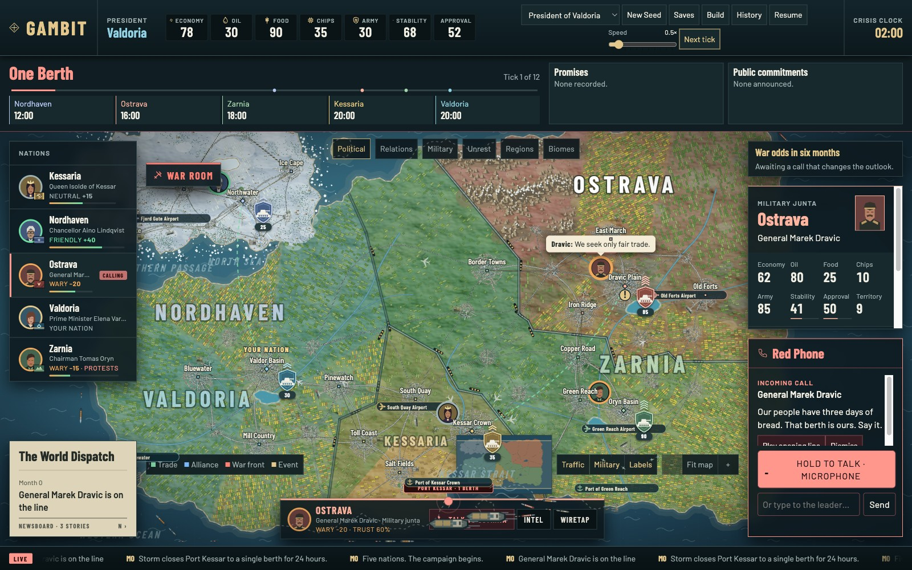
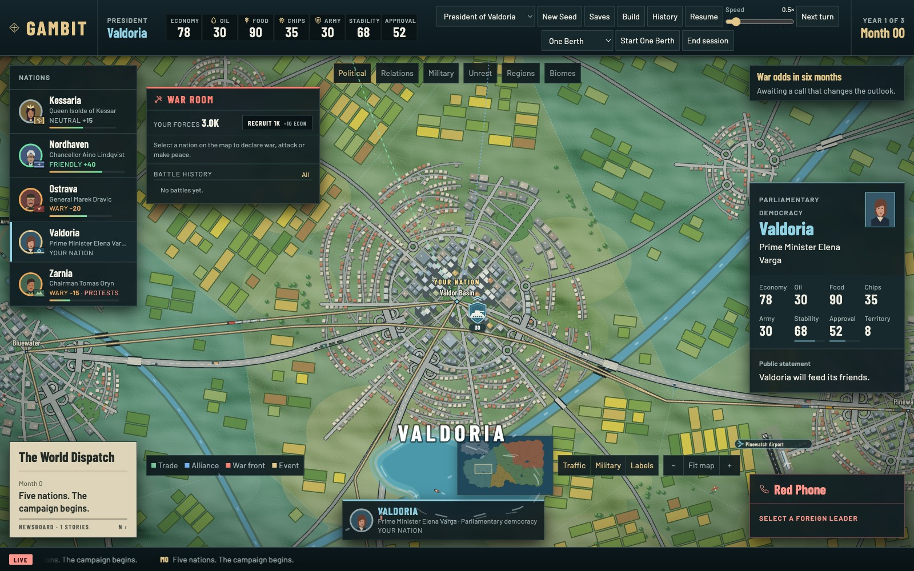

<h1 align="center"></h1>

<p align="center">
  <strong>🏆 Winners of the Best Use of Voxtral API track</strong><br>
  <a href="https://luma.com/le-chonk-in-london">Le Chonk in London · Mistral Vibe Hackathon</a> · 21 November 2026
</p>

<p align="center">
  <a href="#play-locally">Play locally</a> ·
  <a href="#inside-the-red-phone">Inside the Red Phone</a> ·
  <a href="#try-one-berth">Try One Berth</a> ·
  <a href="#under-the-hood">Under the hood</a>
</p>

GAMBIT is a strategy game you play by voice. A storm has closed all but one berth at Port Kessar. Two grain ships need it. General Dravic is already on the Red Phone. You can promise him the berth, call Nordhaven for tugs, or promise both ships the same slot and hope their leaders never compare notes.



> “Our people have three days of bread. That berth is ours. Say it.”
>
> [▶ Hear General Dravic’s opening call · 4 seconds](https://raw.githubusercontent.com/t7acct/Mistral-Hackathon/main/voice/prerendered/e6b69fe65c62569cd79d.mp3)

## Play locally

You’ll need Python 3.12+, Node.js 20.19+ or 22.12+, and a Mistral API key for live calls.

```bash
git clone https://github.com/t7acct/Mistral-Hackathon.git
cd Mistral-Hackathon
```

Create a `.env` file in the project root with `MISTRAL_API_KEY=your_key_here`, then start the game.

```bash
./scripts/demo.sh
```

Open [localhost:5173](http://localhost:5173) in Chrome and allow microphone access. **Hold the red button to speak and release it to send.** Press it while a leader is talking to interrupt. You can also type your side of the call. The launcher installs missing dependencies and starts the API on port 8000.

<details>
<summary><strong>Play offline without an API key</strong></summary>

Run these commands from the project root while online. Once the dependencies are installed, you can use the launcher offline.

```bash
python3 -m venv .venv
.venv/bin/python -m pip install -r requirements.txt
(cd web && npm ci)
./scripts/demo.sh --offline
```

Offline leaders use fixed replies and the microphone returns a sample transcript. Incoming crisis calls and Wiretap conversations play from the recordings shipped with the game.

</details>

<details>
<summary><strong>Check your live setup or change ports</strong></summary>

With the Python dependencies installed and your key configured, run `python scripts/preflight.py` from the project environment to check the models, speech and transcription. To choose different ports, run `./scripts/demo.sh --backend-port 8010 --web-port 5180`.

</details>

## Inside the Red Phone

**What you say.** When you release the button, Voxtral transcribes the clip. We give it names like *Ostrava* and *Port Kessar* as context. The leader answers in character while a separate model records what you promised. At tick 5 of One Berth, Ostrava and Zarnia compare notes. If you offered both the same berth, you can hear them discussing it on Wiretap.

**How they answer.** Each of the five leaders has a distinct Voxtral voice. The leader chooses an emotion with each reply, and playback begins as soon as the first chunk of speech arrives. We recorded the scripted incoming calls with the same voices so the phone can ring on cue.

**When you cut in.** Press talk while Dravic is announcing a blockade and you can stop him before he commits to it publicly. He remembers the interruption. The talk button also measures how long you hesitate before answering, and each leader reacts according to their temperament.

In our live playtest of One Berth, all 13 player calls were transcribed and all 13 replies were spoken. [Voxtral implementation and measurements](voice/VOXTRAL.md)

## Try One Berth

Choose **Valdoria**, set the seed to **7**, and call Queen Isolde of Kessaria to offer a trade deal. Then start **One Berth**.

| When | What to try |
| --- | --- |
| The first call | Promise Dravic the berth. Call Chairman Oryn of Zarnia and offer him the same slot. |
| Tick 4 | Ask Chancellor Lindqvist of Nordhaven to send tugs. She can open a second berth before nightfall. |
| Tick 5 | The leaders compare notes. Open **Wiretap** to hear what they say about you. |
| Tick 7 | When Dravic calls about a blockade, interrupt and offer him the morning slot. |
| After the deadlines | Check the six-month war forecast. Drag the replay slider to **+3** to see who would have decided differently if you’d called later. End the session for the election count and historian’s verdict. |

| Valdor Basin at the start of the campaign | Ostrava and Zarnia on Wiretap after tick 5 |
| --- | --- |
|  |  |

<details>
<summary><strong>Explore the rest of the game</strong></summary>

Govern one of five nations for a three-year term. Each month you can set tariffs, propose alliances, build factories, lay rail or recruit troops. Elections and coups can end your term early. In the War Room you can move armies province by province and negotiate peace. As an independent mediator, you see public positions and are judged on your calls alone.

Four crisis cards ship with the game. **One Berth** puts two grain ships in competition for the same dock. **Grey Fever** gives two countries one vaccine batch. **Colonels’ Coup** opens with tanks in Ostrava’s capital. **Pipeline Cut** starts when Ostrava shuts the northern oil line. Each crisis runs for 12 ticks, and each leader has a deadline of their own.

</details>

## Under the hood

| Component | Role in the game |
| --- | --- |
| Voxtral Mini Transcribe 3 · `voxtral-mini-transcribe-3` | Transcribes the player’s speech with context for names and crisis vocabulary. |
| Voxtral Mini TTS · `voxtral-mini-tts-3-0` | Streams replies in five cast voices, with emotion tags chosen by the leaders. |
| Mistral Large 2512 · `mistral-large-2512` | Writes the short, in-character phone reply. Mistral Medium races it if a reply runs slow. |
| Mistral Large 4 · `mistral-large-4` | Writes private strategies, interprets deals and changes in trust, and generates Wiretap dialogue, replay explanations and the historian’s verdict. |
| Mistral Medium · `mistral-medium-latest` | Chooses each leader’s monthly and crisis actions from legal moves ranked by their advisers. |
| Mistral Vibe | Eight MCP tools let Vibe inspect and play a running game. Two skills help brief the player and draft new crisis cards. [Vibe setup](gambit_mcp/README.md) |

The simulation is deterministic. The war forecast plays out the same seeds before and after your intervention. The replay runs the crisis again with your calls shifted up to five ticks earlier or later. War Room battles use a separate real-time clock.

<details>
<summary><strong>Hackathon benchmarks and playtesting</strong></summary>

On the final hackathon build, the live demo passed all 11 steps in 139 seconds. A typed line took 1.4–3.4 seconds to get a reply. The war forecast took 2.5 seconds for 120 rollouts, and the replay took 4.6 seconds including the written explanations.

An earlier benchmark measured 10 live voice calls.

| Step | Median | Slowest |
| --- | ---: | ---: |
| Generate the leader’s reply text | 1.39 s | 3.11 s |
| Receive the first chunk of speech | 0.39 s | 1.27 s |
| Transcribe a 220 KB WAV | 3.32 s | 8.72 s |
| Interpret the deal in the background | 13.10 s | 21.44 s |

Chrome microphone clips took 0.25–0.37 seconds to transcribe in a separate six-call test. In a simulated noisy room, word accuracy held at about 98% down to a 10 dB signal-to-noise ratio. An early Managed Agents prototype took 9.6 seconds per turn, so the game uses chat completions and keeps leader memory in the session. [Prototype results](agents/A0_RESULTS.md)

One Berth received the most live playtesting. The other three cards were exercised offline. War, economy and elections had less live play before the demo. All five leaders share one API key, so concurrent games can slow the phone replies.

</details>

<details>
<summary><strong>Source map and test commands</strong></summary>

| Area | Source |
| --- | --- |
| Simulation, crisis clock, forecasts and saves | [engine/](engine/) |
| Leader personas, decisions and deal interpretation | [agents/](agents/) |
| Red Phone, Voxtral speech and Wiretap | [voice/](voice/) |
| Campaign map, Intel, construction and election UI | [web/](web/) |
| Battles, peace terms and crisis replay | [war/](war/) · [replay/](replay/) |
| API contracts, nations and crisis cards | [contracts/](contracts/) · [data/](data/) |
| Demo path, offline server and browser walkthroughs | [e2e/](e2e/) |

Run the checks from the project’s Python environment.

```bash
python -m pytest -q                  # offline test suite
./scripts/smoke.sh                   # smoke test with stub leaders
python -m e2e.demo_path              # full demo against live models
python -m e2e.demo_path --url http://127.0.0.1:8000
python -m e2e.timings                # live latency benchmark
```

For browser walkthroughs, install Playwright with `python -m pip install playwright` and `python -m playwright install chromium`. Then run `python -m e2e.walkthrough --offline` or `python -m e2e.crisis_cards`.

</details>

## Team

Tamim Atiqur, Om Dhande, Abi and Ashish Kadari built GAMBIT in one day at Le Chonk in London.
